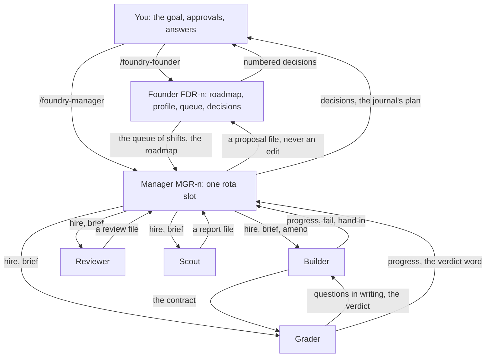
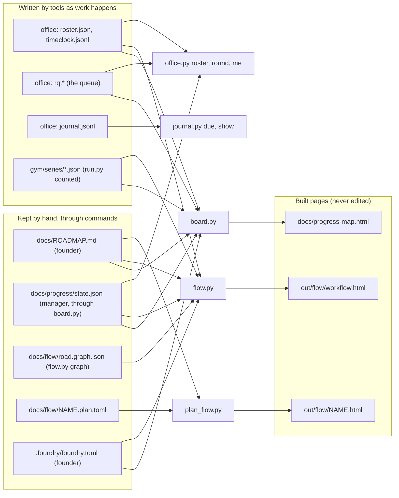

# Concepts

The ideas the tools and skills rest on. Each section says what the thing is, who owns it, and which tool keeps it.

- [The levels](#the-levels)
- [Badges and the time clock](#badges-and-the-time-clock)
- [The rota slot and the work shift](#the-rota-slot-and-the-work-shift)
- [Blocks, checkpoints, milestones, stages, requirements, decisions](#the-words-of-the-plan)
- [The gym in one page](#the-gym-in-one-page)
- [The shared resource and its seats](#the-shared-resource-and-its-seats)
- [The freeze during a counted run](#the-freeze-during-a-counted-run)
- [The journal](#the-journal)
- [Pushes](#pushes)
- [The user's own words](#the-users-own-words)
- [What reads what](#what-reads-what)

## The levels

| Level | Badge | Owns | Never |
|---|---|---|---|
| **You** (the user) | none | The goal, every cut line, every approval, the answer to every decision | |
| **Founder** | `FDR-<n>` | The roadmap, the profile and the rules file, the road graph's shape, plan charts, the queue of shifts and pushes, the decision register | Directs the crew, runs a slot, grades, merges, builds |
| **Manager** | `MGR-<n>` | The current shift: its blocks, the crew, checkpoints, failures, notes, the log, the rota, the journal | Edits the roadmap, the profile or the rules file; grades what it directed |
| **Employees** | `EMP-<n>` (a session), `TMP-<n>` (a temp) | One job each: builder, grader, reviewer, scout | Manage, or touch files outside their brief |

You start the founder and the manager by typing `/foundry-founder` and `/foundry-manager`. No agent makes itself either one. Employees are hired by the manager and load the `foundry-employee` skill.

There is one founder badge and one manager badge at a time. The founder is outside the headcount and cannot hire.



The builder and the grader exchange only written things: the contract, questions, dated amendments. The grader does not open the builder's code.

## Badges and the time clock

A badge is one signed line:

```
FB1 ID:EMP-01 NAME:M1-BUILDER ROLE:BUILDER KIND:SESSION SHIFT:START SLOT:SWING ISSUED:1795554920 SIG:6TNBQE54VOAJ33GL
```

The first word is the profile's `badge_prefix`. The fields are the id, the name, the role, the kind (session or temp), the work shift, the rota slot and the time of issue. `SIG` is an HMAC-SHA256 of the rest, cut short and written in base32. With `segno` installed the line is also drawn as a QR plate (`<office>/badges/<id>.svg`).

Clocking in is presenting the line. Every punch (in, progress, fail, hand-in, out) is appended to `timeclock.jsonl` in the office, and the roster is worked out from that file. So who is on the clock, their job, their percent and their approximate finish are read, not typed.

**What a badge is.** A claim: "this session is EMP-01, hired for this job, owning these files". It stops mix-ups (a changed or mistyped line is refused) and keeps an honest record of who said what and when.

**What a badge is not.** A credential. The signing key (`badge_key.json`) lies in the office beside the roster, and any session that can run the tools can read it. A badge does not stop a session that sets out to cheat. The Foundry's protection against a wrong result is the independent grader and the manager reading the diff, not the badge.

A badge's status on the roster:

| Word | Meaning |
|---|---|
| `HIRED` | The badge exists; nobody has clocked in with it |
| `UP` | A punch inside the limit. Not proof that the session is running |
| `STALE` | Silent longer than `limits.stale_min` (a manager or founder: `limits.manager_stale_min`) |
| `OVERDUE` | Past its own finish by more than `limits.overdue_min` |
| `OUT` | Clocked out: `done`, `partial`, `failed`, `handed-off`, `lost` or `relieved` |
| `REVOKED` | Replaced by a newer manager or founder badge |

Only `progress` counts as being heard. An employee whose job waits in the resource queue, or holds a seat, stays `UP` by that fact.

A title is the card a badge is hired on. The built-in cards are builder and fixer (role builder), grader (role grader, session only, independent), reviewer (role reviewer, independent), and scout, triager and cleaner (role scout). A card says what the title does, what it may write and what it hands in, and the brief prints it. A project adds cards in the profile ([profile.md](profile.md#titles-flagged-titles-and-models)).

## The rota slot and the work shift

Two different things are called a shift.

- **The rota slot** is hours on the clock. The default rota has three slots: day from 06:00, swing from 14:00, night from 22:00. A slot runs from its start to the next slot's start. Each slot has one manager, and a manager session serves one slot. The slots live in the state file (`rota.slots`); a new state takes them from the profile's `[slots]`.
- **The work shift** is a plan: `shift` in the state file, a list of blocks toward one milestone, with its own `crew_max` (the headcount you set). Behind it is the `queue` of later shifts, which the founder writes.

A slot runs the current work shift. A work shift that does not finish in one slot carries over into the next. It is replaced only by `board.py promote`, and only when every block is done or skipped.

At the end of a slot the manager writes the hand-off and clocks out. The next manager is a fresh session that knows only what was written down.

## The words of the plan

| Word | What it is | Where it lives | Who writes it |
|---|---|---|---|
| **Requirement** | One thing the goal needs, with an id (`APP-01`), a tier (`P0`) and a status | A row of the roadmap | Founder |
| **Stage** | A release stage (`R0`, then the goal, `1.0`) whose exit is a list of requirement ids | A row of the roadmap | Founder |
| **Milestone** | A unit of work (`M1`) that closes requirements, with a reason for its place in the order | A row of the roadmap; its status in the state's `milestones` | Founder; the manager sets the status |
| **Decision** | A question only you can answer (`D7`), with options and a recommendation | The state's `decisions`, through `board.py decide`; the roadmap's decisions table shows the same numbers | Founder or manager asks; you answer |
| **Block** | One step of the current shift, sized to fit a slot, with a `done_when` that can be checked | `shift.blocks` in the state | Founder plans; the manager sets the status |
| **Checkpoint** | The tie between a milestone and its gym lane: which lane, which builder, which grader | The state's `checkpoints` | Manager |
| **Lane** | One measure in the gym (`G1`) | `gym/` | Grader |
| **Failure** | A numbered defect (`F001`) with a plan, an owner and a status | The state's `failures` | Manager, from the crew's reports (`R<seq>`) |

A milestone is done only when its lane says PASS on a counted run. `board.py milestone set M1 --status done` refuses otherwise.

The road graph ([charts.md](charts.md#the-workflow-page-and-the-road-graph)) holds the order: which milestone must come first and which decision gates what.

## The gym in one page

The gym is how "done" is decided. The `gym` skill has the method; [gym.md](gym.md) has the setup. The parts:

| Part | What it is | Who writes it, when |
|---|---|---|
| **Contract** | What is under test, the one command that runs it, the artifacts it leaves in the run folder, what one unit is. `gym/contracts/<lane>-artifacts.md` | The builder, before any code |
| **Prereg** | The pre-registration: the question, the unit, the null to beat, the minimum n, the bar, the controls, the rule that maps results to a verdict word. It pins the contract by sha256. `gym/prereg/<lane>.json` | An independent grader, before any counted data |
| **Lane** | Pure code that reads the run folder and prints a verdict word. `gym/lanes/<lane>_*.py` | The same grader, with the prereg |
| **Dev run** | An uncounted run. It is graded dry and publishes nothing. It decides nothing | Anyone, as often as needed |
| **Counted run** | One run that adds one point to the lane's series file. It needs a clean tree and a registered prereg | The manager queues it, in the checkpoint's block |
| **Series** | The record: one point per counted run. `gym/series/<lane>.json` | `run.py counted` only, never by hand |

The verdict words:

| Word | Meaning |
|---|---|
| `PASS` | The bar is met under the prereg's rule, at n at or above the minimum, and the controls held |
| `MARGINAL` | Inside the noise: the interval straddles the bar |
| `FAIL` | The bar is missed with enough n, and the controls held, so the miss is real |
| `MEASURING` | Too few units so far, or no bar registered yet |
| `STARVED` | Too few units, and the rows show why |
| `VOID` | The instrument broke: a control failed, the wrong thing was graded, the tree or HEAD changed under the run. n is reported as 0 |
| `SATURATED` | Pinned at the maximum: the test is too easy |

**Why the grader is independent.** The one who builds a thing knows what it is good at, and a measure written by that person tends to measure exactly that. So three rules hold:

1. The grader is never the builder, and never the manager who directed the build. `office.py hire` refuses a grader as a temp, because a subagent of the manager is not independent. `board.py checkpoint` refuses a grader who is the builder.
2. The measure is written before the data. The prereg and the lane are committed before the first counted run, and the bar does not move afterwards. A change is a dated amendment that says whether counted data existed.
3. The wall is checked. Only a grader writes the paths in `measure.grader_owned`; `office.py handin` sends back any other badge's branch that changes them. A run's records (`measure.records`) are written by the run and committed by whoever queued it; `handin` sends back a branch that changes them unless the badge is a grader's or the manager's. Both checks read the branch's tree against its base as well as each commit, so a merge that kept one side hides nothing.

The board reads lane verdicts from the series files. Nobody types a verdict into the map.

## The shared resource and its seats

Many projects have one thing the crew cannot all use at once: a dev VM, a GPU, a test device, a licence. The profile names it under `[resource]` and lists its **seats**: how many jobs it takes at once, each by name.

`rq.py` is a fair queue over those seats. One job holds a seat at a time. A job is queued under its badge id:

```
python scripts/foundry/rq.py run --id EMP-07 --job "unit tests + lint" --touched "src/app" --max 30m -- <command>
```

The queue picks a free seat, runs the profile's `prepare` line there, runs the command with the seat's name in an environment variable (`FOUNDRY_SEAT` by default), and releases the seat whatever the command's exit.

- **Order.** Lower `--prio` first, then first come. 0 is for counted runs and their dry runs, 1 the slot-end checks, 2 the critical path the manager names, 5 everyone else. A waiter older than 90 minutes ranks at prio 2, so nobody starves.
- **One job per badge.** A second job under an id that waits or holds a seat is refused.
- **Whole-resource jobs.** `--all-seats` waits until every seat is free and holds them all. Counted runs use it when the seats share state.
- **Exclusive jobs.** Jobs that cannot run side by side even in different seats are marked by a regex in the profile or by `--exclusive`.
- **Limits.** A hold is `resource.default_max` long (30 minutes) unless `--max` says otherwise. Every time carries a unit (`30m`, `2h`); a bare number is refused. Past its limit a hold reads `OVERDUE`. Ending an overrunning job is opt-in (`resource.enforce_max`).
- **Stopping.** Each `run` job runs in a process group of its own. Stopping `rq.py run` (Ctrl+C, TERM, HUP, or BREAK on Windows) ends the job with everything it started and releases the seat.

Nobody uses the resource outside the queue, the manager included. A badge hired with `--rq` reaches it through the queue; a badge hired with `--seat NAME` has one seat of its own outside the queue's seats.

A project with no shared resource leaves `resource.name` empty. Then `rq.py` has nothing to do, and `hire --rq` is refused.

## The freeze during a counted run

A counted run samples the tree it was started at. A change under it, tracked or untracked, voids the run. So while a counted run is waiting or running, nothing in the main checkout may change: no commit, no merge, no untracked file, no map rebuild.

The tools know a freeze is on in two ways.

**By the queue's ids.** In a project with a shared resource, a counted run is queued under a marked id:

| Id | Meaning |
|---|---|
| `<badge id>-counted-<lane>` (or `<badge id>-counted`) | One counted run, for example `MGR-2-counted-G1` |
| `<badge id>-sweep` | A counted sweep of every lane (`sweep.py` uses it) |

While such an id holds a seat or waits in the queue, the roster says `COUNTED SWEEP or run in the queue`, every `me` says so, and `board.py` holds its edits. The id is what marks it. A prio-0 or all-seats job under a plain id only reads as a possible counted run.

**By `office.py freeze`.** A project with no shared resource has no queue to read. The manager marks the freeze by hand:

```
python scripts/foundry/office.py freeze on --by "<the manager's line>" --why "counted G1" --lane G1 --max 1h
python scripts/foundry/office.py freeze off --by "<the manager's line>" --note "run ended"
```

This writes and removes `freeze.json` in the office. `--max` takes a unit; a bare number is refused. `sweep.py` turns the same freeze on for its whole run and off at its end, with or without a shared resource, because between two lanes its queue id neither holds nor waits. `freeze off` lifts a sweep's own freeze only with `--force`.

A `freeze.json` that cannot be read counts as a freeze that is on, by "unknown": a tool that cannot tell holds still.

**What a freeze does.** In the main checkout, during either kind:

- `board.py` and `board.py check` print but do not rewrite the map.
- `board.py init` and `promote` are refused.
- Every `board.py` edit command is checked, then **held**: written to `pending-state.jsonl` in the office with its own time, and applied by the next writing command run in the main checkout after the freeze ends. `board.py pending` lists what is held. An edit that names an item by its number (`blocker rm 2`) is held by the item's text, so it finds the same item at the replay; one whose item is gone by then stays in the file with the reason, and the others are still applied.
- `flow.py graph` edits (`seed`, `link`, `unlink`, `confirm`, `node`, `undo`), `gym_init.py init` and `lane add`, and `plan_flow.py new` are refused there (exit 3). Reading commands and `gym_init.py check` are not, and a `plan_flow.py` build may write only under the git-ignored output folder.
- The roster and every `office.py me` say FREEZE, and `office.py handin` adds a warning.

Employees keep working: they commit in their own worktrees, and the manager merges after the run's records are committed.

A hold or a freeze that is past its own limit is probably dead (the host restarted, the session is gone). Edits are still held, but they exit 4 and say `DEAD?` until the manager frees the seat with `rq.py force-release` or ends the freeze with `office.py freeze off`.

Not every write is checked by a tool. A hand edit of a file or a `git commit` during a freeze is stopped only by the rule.

## The journal

The shift journal is where the crew fixes its own way of working. It holds holes in the skills, the tools and the briefs, failures of the process (a rule that did not hold, a wrong instruction, a slip), and improvements. It does not hold what the build does: a failing test or run is `office.py fail`, and no run outcome or verdict goes into a journal entry.

1. **Logged when noticed.** Anyone with a badge runs `journal.py add`. It prints an id such as `J12`.
2. **Planned by the manager.** `journal.py plan` gives an entry its fix, files and owner. An entry may instead be closed: `fixed`, `covered` (a duplicate, or a rule already says it), `dropped`, or `left` to a named owner.
3. **Ready an hour before the slot ends.** `journal.py ready` refuses while an entry has no plan, then writes a plan file for you. `journal.py due` prints the time; `board.py check` warns from then on.
4. **Approved by you.** `journal.py approve --words "..."` records your words. Only approved fixes are built. Planning an approved entry again clears its approval.
5. **Merged at a slot boundary.** A change to a skill, a tool or a brief lands between slots, after a review. Crew on the clock keep the brief they were given.

Lessons carry between crews. The profile's `[crews]` table names other crews that work this way. An entry marked `carry --to <crew>` reaches that crew's outbox once it is fixed or approved, and that crew's manager takes it into its own journal with `journal.py take`.

## Pushes

A project can run shift after shift with no further planning. A **push** is for when you want a lot done inside a window: before a usage reset, a demo, a release. It is a dated stretch of rota slots that drives named milestones to a verdict, with its own usage budget, a freeze and a close.

- The founder plans it: `founder.py audit`, a plan chart, then `founder.py push new NAME`, which writes a draft with the usage budget, the resource's seats, the open failures and the open decisions filled in from the state.
- You approve it. Your words go into the draft with the time.
- Only then do its shifts go into the state's `queue`, each with its own `crew_max`.
- It ends with a freeze, a counted sweep of every lane ([gym.md](gym.md#the-sweep)) and a close note.

The `foundry-founder` skill's `references/push.md` is the routine.

## The user's own words

An approval or an answer is recorded as you typed it, in quotation marks, with the time. The tools ask for the words:

| Command | What the words record |
|---|---|
| `board.py decide answer D7 --words "..."` | Your answer to a decision |
| `journal.py approve --by LINE --words "..."` | Your approval of the journal's plan |
| `board.py shift set --crew-max 4 --words "..."` | A headcount or a heavy-work approval: your numbers |
| `board.py milestone set M1 --status done --force --words "..."` | Your override of a milestone whose lane has not passed |

Each refuses empty words.

Why verbatim:

- **A summary drifts.** "The user approved the plan" loses which part, and under what condition. The next manager is a fresh session that acts on what is written. If the writing is a paraphrase, it acts on the paraphraser's reading.
- **Agents talk to each other.** A timer's prompt, another session's message or a quote relayed by someone else can look like an instruction from you. None of them is. Only what you typed in that agent's own session counts.
- **No answer is not a yes.** An open decision that stops a block goes on the blockers with you as its owner, and work moves to a block that does not need it.

When an agent had to interpret an answer, it records your words, and marks its reading as its own.

## What reads what

Nothing is typed that can be read. Each page is built from files someone else keeps, and warns when they disagree.



The shapes of these files are in [state.md](state.md).
